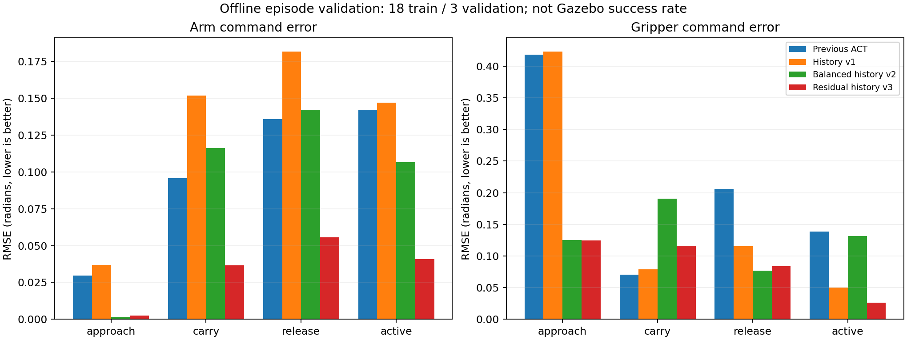

# UR5eの学習・評価結果

21回の記録をエピソード単位で18回の学習と3回の評価に分けました。評価はep1・ep13・ep15です。
元データと以前のモデルは維持しています。Gazeboでのアーム操作・成功率測定は実施していません。

| モデル | 全段階のアームRMSE (rad) | 動作対象点のアームRMSE (rad) | 指のRMSE (rad) | 開閉判定の不一致 |
|---|---:|---:|---:|---:|
| Previous ACT | 0.0995 | 0.1420 | 0.2618 | 37.9% |
| History v1 | 0.1416 | 0.1469 | 0.2452 | 31.5% |
| Balanced history v2 | 0.1087 | 0.1064 | 0.1403 | 10.0% |
| Residual history v3 | 0.0394 | 0.0407 | 0.1088 | 6.8% |

動作対象点は、手本の目標角と現在角との差がいずれかのアーム関節で0.01radを超える点です。
段階ラベルは指令から分類したもので、把持成功を確認したラベルではありません。

## 変更した学習方法

- 過去8点（20Hzで0.35秒の履歴幅）の関節角と、切り出し開始からの経過時間を入力。
- 初動1秒前から最終指令変更5秒後までを使用。指の開閉待機を保持。全切り出し範囲はdata_split.jsonへ保存。
- 正規化統計は学習18回だけで算出。微小な関節ノイズを過度に拡大しないよう標準偏差に下限を設定。
- CPU向けの小型ACTへ変更し、VAEの潜在変数を使わない予測誤差の学習。chunk_size=128、n_action_steps=4を維持。
- v2では操作段階を均等に抽出し、実行対象の先頭4点を8倍に重み付け。
- v3では、さらに絶対目標角ではなく予測時点の現在角からの修正量を学習。推論時に予測時点の角度を足し戻す。
- 各モデルを5000ステップ学習し、500ステップごとに評価。動作対象点のアームRMSEと全体の指RMSEの和で保存モデルを選択。

v1の選択ステップ: 500。v2の選択ステップ: 5000。

v3の選択ステップ: 1500。

## 結果の限界

以前のモデルは全21回を学習済みなので、以前のモデルにとっては未知データではありません。
評価3回はモデル選択にも使っています。独立した最終テスト用の記録は別途必要です。
経過時間を入力に含むため、固定配置の作業を同じ開始条件で行う用途です。時間変動や新しい物体位置への対応は未確認です。
オフラインの指令誤差が改善しても、閉ループで動き出すことや運搬成功は保証しません。
把持待機などの実行補助も残るため、結果をモデル単独の成功率として扱わないでください。

